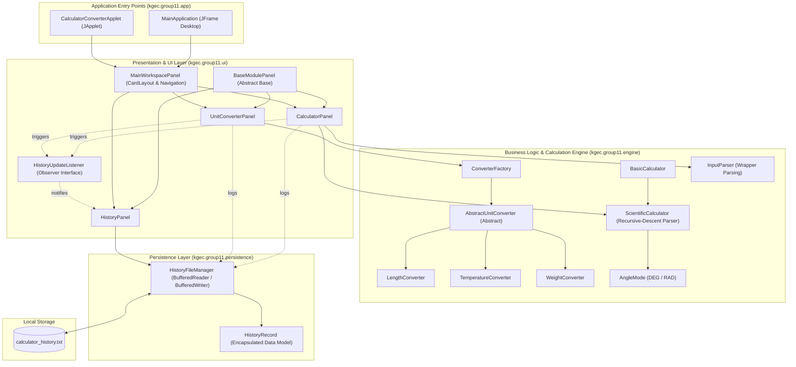
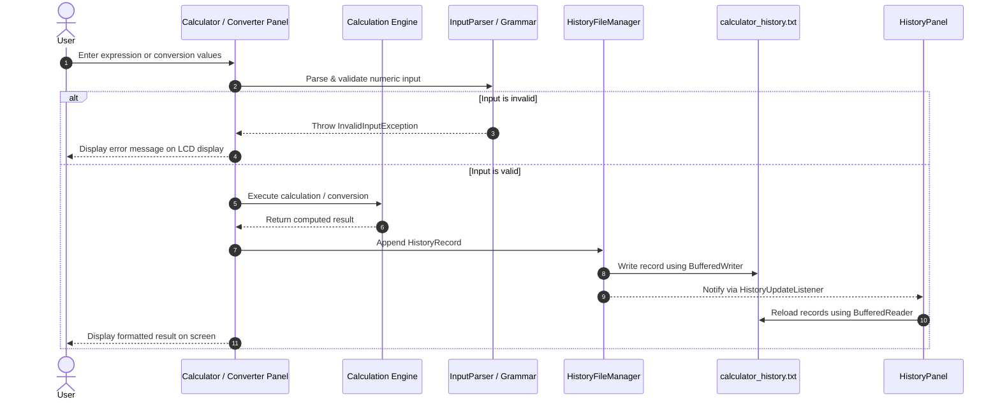

# Interactive Graphical Calculator and Unit Converter Applet

<p align="center">
  
  
  
  
  
</p>

---

## 🏛️ Academic & Institutional Details

> **Institution:** Kalyani Government Engineering College, Department of Computer Science and Engineering  
> **Course:** Object-Oriented Programming Lab (PCC-CS593) | Academic Year: 2026–2027 (Odd Semester)  
> **Group:** Group 11  
> **Faculty Supervisors:** Anup Kumar Biswas, Manju Biswas, Kuntal Bhowmick (Assistant Professors)

### 👥 Group Members
| # | Student Name | University Roll Number | Department |
|:---:|:---|:---:|:---:|
| 1 | **Pritam Das** | `10200124048` | Computer Science and Engineering |
| 2 | **Sanket Sau** | `10200124008` | Computer Science and Engineering |
| 3 | **Soumyadip Dey** | `10200124010` | Computer Science and Engineering |
| 4 | **Satyanarayan Banerjee** | `10200124017` | Computer Science and Engineering |
| 5 | **Rakesh Dolui** | `10200124070` | Computer Science and Engineering |

---

## 📑 Table of Contents
- [Features Implemented](#-features-implemented)
- [Package & OOP Architecture](#-package--oop-architecture)
  - [Layered Architecture Diagram](#layered-architecture-diagram)
  - [UML Class Hierarchy Diagram](#uml-class-hierarchy-diagram)
- [How to Run](#-how-to-run)
  - [Option 1: Run the Pre-Built Executable JAR (Fastest)](#option-1-run-the-pre-built-executable-jar-fastest)
  - [Option 2: Compile & Run from Source](#option-2-compile--run-from-source)
  - [Option 3: Run as a Java Applet (JDK 8 appletviewer)](#option-3-run-as-a-java-applet-jdk-8-appletviewer)
  - [Option 4: Run the Automated Unit Test Suite](#option-4-run-the-automated-unit-test-suite)
- [Command-Line Arguments](#-command-line-arguments)
- [Repository Structure](#-repository-structure)
- [Operational Workflow & Storage Design](#-operational-workflow--storage-design)

---

## ✨ Features Implemented

- 🧮 **Scientific & Arithmetic Calculator:**  
  Basic arithmetic (`+`, `-`, `×`, `÷`, `%`, `^`, `1/x`, `+/-`), trigonometric & inverse trigonometric functions (`sin`, `cos`, `tan`, `asin`, `acos`, `atan`) with `DEG`/`RAD` toggle, logarithms (`log10`, `ln`), roots (`sqrt`, `cbrt`), powers (`x^2`, `x^3`, `e^x`), factorial (`n!`), constants (`π`, `e`), memory registers (`MC`, `MR`, `M+`, `M-`), and a full recursive-descent mathematical expression evaluator.

- 🔄 **Multi-Category Unit Converter:**  
  Converts **Length** (m, km, cm, mm, mi, yd, ft, in), **Temperature** (°C, °F, K with absolute-zero validation), and **Weight** (kg, g, mg, t, lb, oz) with unit swap and an instant all-equivalents reference table.

- 💾 **Flat-File History Persistence:**  
  Automatically logs calculations and conversions to a local flat text file (`calculator_history.txt`) with reload, export, and clear actions (no external database used).

- 🖥️ **Dual Execution Modes:**  
  Runs as a standalone Swing/AWT desktop application (`MainApplication` extending `JFrame`) on JDK 8–21+ and as a classic Java Applet (`CalculatorConverterApplet` extending `JApplet`) via `appletviewer` on JDK 8.

---

## 🏗️ Package & OOP Architecture

| Package | Key Classes & Interfaces | Core OOP Principles & Responsibilities |
|:---|:---|:---|
| `kgec.group11.exception` | `CalculationException`, `DivisionByZeroException`, `InvalidMathDomainException`, `InvalidInputException`, `InvalidUnitException` | **Custom Exception Hierarchy** — Encapsulates domain-specific arithmetic, input, and boundary validation errors. |
| `kgec.group11.engine` | `BasicCalculator` → `ScientificCalculator`, `AbstractUnitConverter` → `LengthConverter`, `TemperatureConverter`, `WeightConverter`, `ConverterFactory`, `AngleMode`, `InputParser` | **Inheritance, Abstraction & Polymorphism** — Extensible engine design with factory pattern and numeric wrapper parsing (`Double.parseDouble()`, `Double.valueOf()`, `Integer.valueOf()`). |
| `kgec.group11.persistence` | `HistoryRecord`, `HistoryFileManager` | **Flat-File Persistence** — Stream-based file I/O operations using `BufferedReader`, `BufferedWriter`, `FileReader`, and `FileWriter`. |
| `kgec.group11.ui` | `BaseModulePanel` → `CalculatorPanel`, `UnitConverterPanel`, `HistoryPanel`, `MainWorkspacePanel`, `HistoryUpdateListener` | **GUI Inheritance & Event-Driven Architecture** — Modular UI panels with Swing/AWT layout managers and decoupled listeners (`ActionListener`, `ItemListener`, `KeyListener`). |
| `kgec.group11.app` | `CalculatorConverterApplet` (`JApplet`), `MainApplication` (`JFrame`) | **Dual Entry Points** — Execution adaptors with command-line argument configuration (`--tab`, `--angle`, `--history`). |
| `kgec.group11.test` | `ProjectTestSuite` | **Automated Verification** — Self-contained test harness covering 44 unit tests with zero third-party dependencies. |

### Layered Architecture Diagram



### UML Class Hierarchy Diagram

```mermaid
classDiagram
    direction TB

    class BaseModulePanel {
        <<abstract>>
        #initLayout()*
        #registerListeners()*
    }
    class CalculatorPanel {
        -ScientificCalculator calculator
        -AngleMode currentAngleMode
        +actionPerformed(ActionEvent e)
    }
    class UnitConverterPanel {
        -ConverterFactory factory
        +itemStateChanged(ItemEvent e)
    }
    class HistoryPanel {
        -HistoryFileManager historyManager
        +onHistoryUpdated()
    }
    BaseModulePanel <|-- CalculatorPanel
    BaseModulePanel <|-- UnitConverterPanel
    BaseModulePanel <|-- HistoryPanel

    class BasicCalculator {
        +add(double a, double b) double
        +subtract(double a, double b) double
        +multiply(double a, double b) double
        +divide(double a, double b) double
        +modulo(double a, double b) double
        +power(double base, double exp) double
    }
    class ScientificCalculator {
        +sin(double val, AngleMode mode) double
        +cos(double val, AngleMode mode) double
        +tan(double val, AngleMode mode) double
        +log10(double val) double
        +ln(double val) double
        +sqrt(double val) double
        +factorial(int n) double
        +evaluateExpression(String expr) double
    }
    BasicCalculator <|-- ScientificCalculator

    class AbstractUnitConverter {
        <<abstract>>
        +convert(double val, String from, String to)* double
        +getSupportedUnits()* List~String~
    }
    class LengthConverter {
        +convert(double val, String from, String to) double
    }
    class TemperatureConverter {
        +convert(double val, String from, String to) double
    }
    class WeightConverter {
        +convert(double val, String from, String to) double
    }
    AbstractUnitConverter <|-- LengthConverter
    AbstractUnitConverter <|-- TemperatureConverter
    AbstractUnitConverter <|-- WeightConverter

    class CalculationException {
        <<exception>>
    }
    class DivisionByZeroException {
        <<exception>>
    }
    class InvalidMathDomainException {
        <<exception>>
    }
    CalculationException <|-- DivisionByZeroException
    CalculationException <|-- InvalidMathDomainException
```



---

## 🚀 How to Run

### Option 1: Run the Pre-Built Executable JAR (Fastest)

Run directly with standard defaults:
```bash
java -jar Group11_CalculatorConverter.jar
```

Optional command-line arguments:
```bash
java -jar Group11_CalculatorConverter.jar --tab=converter --angle=RAD
```

---

### Option 2: Compile & Run from Source

- **Linux / macOS:**
  ```bash
  chmod +x run.sh
  ./run.sh
  ```

- **Windows:**
  ```cmd
  run.bat
  ```

- **Manual Compilation & Execution:**
  ```bash
  mkdir -p build
  javac -d build $(find src -name "*.java")
  java -cp build kgec.group11.app.MainApplication
  ```

---

### Option 3: Run as a Java Applet (JDK 8 `appletviewer`)

Launch the applet via the HTML wrapper:
```bash
appletviewer CalculatorConverterApplet.html
```

Or explicitly passing the included policy file:
```bash
appletviewer -J-Djava.security.policy=applet.policy CalculatorConverterApplet.html
```

> [!NOTE]
> A local `applet.policy` is provided in the repository and `~/.java.policy` is configured to grant file permissions for history logging.

---

### Option 4: Run the Automated Unit Test Suite

Execute the comprehensive test suite verifying arithmetic, scientific functions, conversions, exceptions, and file persistence:
```bash
java -cp Group11_CalculatorConverter.jar kgec.group11.test.ProjectTestSuite
```

---

## ⚙️ Command-Line Arguments

The standalone desktop application (`MainApplication`) supports configurable startup parameters:

| Argument | Valid Values | Default | Description |
|:---|:---|:---:|:---|
| `--tab=<tab_name>` | `calc`, `converter`, `history` | `calc` | Sets the initially active tab on application launch. |
| `--angle=<mode>` | `DEG`, `RAD` | `DEG` | Configures the default trigonometric angle mode. |
| `--history=<file_path>` | Any valid path string | `calculator_history.txt` | Overrides the target file for logging and exporting session history. |

---

## 📂 Repository Structure

```text
Group11_Calculator_UnitConverter_Applet/
├── CalculatorConverterApplet.html      # HTML deployment page for Java Applet
├── Group11_CalculatorConverter.jar     # Standalone pre-compiled executable JAR
├── README.md                           # Comprehensive project documentation
├── applet.policy                       # Java security policy for applet file I/O permissions
├── calculator_history.txt              # Flat-file session history database
├── run.bat                             # Windows automated compilation and launch script
├── run.sh                              # Linux/macOS automated compilation and launch script
└── src/
    └── kgec/
        └── group11/
            ├── app/                    # Application and Applet launcher entry points
            │   ├── CalculatorConverterApplet.java
            │   └── MainApplication.java
            ├── engine/                 # Core calculation and unit conversion business logic
            │   ├── AbstractUnitConverter.java
            │   ├── AngleMode.java
            │   ├── BasicCalculator.java
            │   ├── ConverterFactory.java
            │   ├── InputParser.java
            │   ├── LengthConverter.java
            │   ├── ScientificCalculator.java
            │   ├── TemperatureConverter.java
            │   └── WeightConverter.java
            ├── exception/              # Custom application exception hierarchy
            │   ├── CalculationException.java
            │   ├── DivisionByZeroException.java
            │   ├── InvalidInputException.java
            │   ├── InvalidMathDomainException.java
            │   └── InvalidUnitException.java
            ├── persistence/            # Flat-file history persistence manager
            │   ├── HistoryFileManager.java
            │   └── HistoryRecord.java
            ├── test/                   # Comprehensive automated test suite (44 test cases)
            │   └── ProjectTestSuite.java
            └── ui/                     # Swing & AWT interactive graphical user interface
                ├── BaseModulePanel.java
                ├── CalculatorPanel.java
                ├── HistoryPanel.java
                ├── HistoryUpdateListener.java
                ├── MainWorkspacePanel.java
                └── UnitConverterPanel.java
```

---

## 📊 Operational Workflow & Storage Design



---

<p align="center">
  <b>Department of Computer Science and Engineering</b><br>
  Kalyani Government Engineering College &bull; Academic Year 2026–2027
</p>
